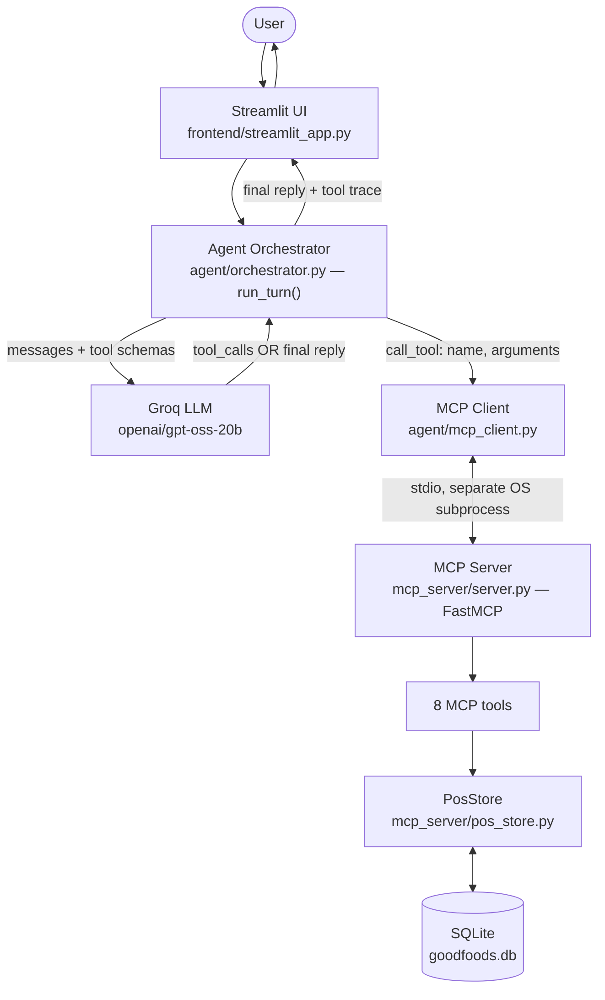

# GoodFoods AI Reservation Agent

Restaurant-reservation conversational agent for a 50-100 location chain:
official MCP SDK, a hand-written LLM tool-calling loop (no framework),
SQLite-backed persistence.

## Submission

- **Part 1 — Business Strategy:** [`docs/GoodFoods_Business_Strategy.docx`](docs/GoodFoods_Business_Strategy.docx) · [Notion version](https://app.notion.com/p/GoodFoods_Business_Strategy-3d442864f284806a8b52d45b44d5d2c1?source=copy_link) · summarized in [Business Strategy Summary](#business-strategy-summary)
- **Part 2 — Technical Implementation:** this repository — code below, [demo video](docs/demo/sarvam_assignment_demo.mp4), [example conversations](#example-conversations)
- **Resume:** [`docs/resume.pdf`](docs/resume.pdf)

## Demo Video

[`docs/demo/sarvam_assignment_demo.mp4`](docs/demo/sarvam_assignment_demo.mp4)
— discovery/recommendation, a live booking, a modification, and a
cancellation, with the tool-call trace shown for each step.

## Contents

[Overview](#overview) · [Architecture](#architecture) · [How It Works](#how-it-works) ·
[Model](#model) · [Prompt Engineering](#prompt-engineering-approach) · [Tools](#tools) ·
[Recommendations](#recommendation-system) · [Reservation Logic](#reservation-logic) ·
[Error Handling](#error-handling) · [Example Conversations](#example-conversations) ·
[Business Strategy](#business-strategy-summary) · [Assumptions](#assumptions) ·
[Limitations](#limitations) · [Future Enhancements](#future-enhancements) ·
[Setup](#setup) · [Testing](#testing)

## Overview

A chat agent that finds restaurants, checks live availability, and books,
modifies, or cancels reservations against a real SQLite-backed store —
end to end, through natural conversation, not a menu of buttons.

**Why an agent, not a chatbot:** it reads and writes directly to the
reservation store via tool calls; the store, not the LLM, is the source
of truth. The model never states availability or booking details from
memory — every fact it gives comes from a tool call in that conversation.

## Architecture



Streamlit (UI + session history) → Orchestrator (agentic loop) → Groq
(decides tools) → MCP Client/Server (stdio subprocess) → PosStore →
SQLite. The LLM is the only component that decides which tool to call.

## How It Works

```
user message → LLM (sees full conversation + live MCP tool schemas)
  → replies directly, OR returns tool_calls
      → session.call_tool(name, arguments) over stdio to the MCP server
      → server → pos_store → SQLite → {"success": true/false, ...}
  → result appended, LLM called again → repeats until a final reply
```

**No keyword routing anywhere** — grep the repo, there is none. The
model's reading of `DEFAULT_SYSTEM_PROMPT` plus each tool's own
JSON-schema description (pulled live from `list_tools()`, never
hand-copied) is the only thing deciding which tool gets called.

**MCP** (Model Context Protocol) is the standard used here instead of a
bespoke function-calling wrapper. The server (`mcp_server/server.py`,
built with `FastMCP`) is a **separate OS subprocess** talking real
stdio JSON-RPC, not an in-process mock — killing it mid-conversation
produces a genuine `ClosedResourceError` (see Example #6 below). Tool
discovery is live: add or change a tool in `server.py` and the model
sees it on the next process start, no other code change.

8 tool-call iterations max (`run_turn()`); hitting the cap forces
escalation instead of a 9th model call. Verify the MCP round trip
yourself: `python tests/roundtrip_check.py`.

## Model

The spec asked for "llama-3.3-8b (or similar small model)" — Llama-3.3
only exists as 70B. The original pick, Llama-3.1-8B-Instant on Groq, was
since removed from Groq's lineup entirely (live 404 as of 2026-09-04).
We use **`openai/gpt-oss-20b`** instead — closest small/open model
available, verified live to correctly emit `tool_calls`.
`DEFAULT_GROQ_MODEL` in `agent/orchestrator.py` is the single source of
truth for the model id.

| Model | Provider | API |
|---|---|---|
| `openai/gpt-oss-20b` | Groq | OpenAI-compatible `chat.completions.create` |

## Prompt Engineering Approach

The system prompt (`DEFAULT_SYSTEM_PROMPT`) plus each tool's docstring
is the **only** routing layer — no other code decides intent.

- **Never invent facts.** The model is told it knows nothing beyond what a tool call returns — never invent a name, id, or slot.
- **Ask, don't guess.** Missing details (date, party size, phone, restaurant) get asked for, not assumed.
- **`{"success": false}` is information, not an error** — explained in plain language, never retried with the same arguments. This is what makes the fully-booked → alternatives flow (Example #5) work with no special-case code.
- **Safety lives in the tools, not the prompt.** Off-grid slots and capacity/double-booking are rejected structurally, regardless of what the model does.
- **Escalation is forced in code, never left to the model** — a model offered "just once more" can rationalize retrying forever.
- **Multi-turn context** is just the persisted message list — "move that to 9pm" resolves against context already in the conversation, no separate memory layer.

## Tools

| Tool | Purpose | R/W | Example |
|---|---|---|---|
| `ping` | Liveness check | R | `ping()` |
| `search_restaurants` | Hard filter by cuisine/location/price/capacity | R | `search_restaurants(cuisine="Italian")` |
| `check_availability` | 6 fixed slots for a date + which are open | R | `check_availability(46, "2026-10-05", 2)` |
| `recommend_restaurants` | Ranked, availability-gated suggestions | R | `recommend_restaurants(date=..., party_size=2)` |
| `create_reservation` | Book (capacity + double-booking guarded) | W | `create_reservation(46, "Alex", "555-0100", 2, "2026-10-05 19:00")` |
| `modify_reservation` | Change party size and/or slot | W | `modify_reservation(7, slot="2026-10-05 21:00")` |
| `cancel_reservation` | Cancel; frees seats + slot immediately | W | `cancel_reservation(7)` |
| `escalate_to_human` | Staff handoff (stub, see [Limitations](#limitations)) | W | `escalate_to_human(reason="refund")` |

## Recommendation System

Five weighted 0–1 signals summing to 1.0: **cuisine match** (0.30),
**vibe/preference match** (0.25), **rating** (0.20), **price fit**
(0.15), **proximity** — same-neighborhood-or-not, no real geo data
(0.10). **Availability is a hard gate before scoring**, not a sixth
signal — zero open slots means excluded, no score can compensate.

Computed deterministically in code from stored attributes, not asked of
the LLM — reproducible, auditable (`score_breakdown` returned per
candidate), and immune to hallucinating an unbookable restaurant.

## Reservation Logic

- **Availability:** 6 fixed daily slots (11:00–21:00, every 2 hrs).
- **Capacity validation:** every create/modify re-checks total booked seats against restaurant capacity.
- **Duplicate-booking protection:** same phone + restaurant + slot is rejected even if capacity allows it.
- **Cancel frees both checks immediately**, enabling instant rebooking of that slot.
- **Persistence:** real SQLite file — Streamlit reruns the whole script per interaction, so state must survive outside Python memory.

Pytest-covered (`test_pos_store.py`): exact-capacity fit, over-capacity
rejection, double-booking rejection, cancel-then-rebook, failed
modification leaves original untouched.

## Error Handling

1. **Business errors** (`{"success": false, ...}`) — valid data, handed to the model, never retried.
2. **Tool/transport failures** (a call raises) — retried 3x with backoff (0.5s/1s/2s), then `escalate_to_human` **directly in code**.
3. **LLM/API failures** — not retried (a rate-limit wait is too long mid-conversation); straight to forced escalation.
4. **Iteration cap** (8 rounds) — same forced-escalation path if the model never converges.

If even escalation fails, the user gets a fixed apology, never a crash
(Example #6). All paths pytest-covered against a scripted fake LLM, no
API key needed.

## Example Conversations

All real, captured from a live run against the actual Groq API and MCP
server (`python tests/manual_conversations.py`, 2026-09-07) — not
hand-written.

| # | Journey | User says | Tools called | Outcome |
|---|---|---|---|---|
| 1–2 | Discovery → booking | *"Book a table for 2 at an Italian place, 2026-10-05 ~7pm, pick a good one"* | `recommend_restaurants` → `check_availability` → `create_reservation` | Confirmed: The Bold Terrace, 19:00, id=7 |
| 3 | Modification | *"Move that to 9pm"* | `modify_reservation` | Same id=7, slot now 21:00 — resolved from context, no re-lookup |
| 4 | Cancellation | *"Cancel that reservation"* | `cancel_reservation` | id=7 status → cancelled |
| 5 | Edge: unavailable | *"Book X; if full, suggest another"* | `search_restaurants` → `check_availability` → `recommend_restaurants` | X fully booked → 5 real alternatives offered, X correctly excluded |
| 6 | Edge: transport failure | *(MCP subprocess killed mid-call, via `psutil`)* | `check_availability` ×3 fails → `escalate_to_human` also fails | Plain apology + retry-later message, no crash, no traceback |

*(Honest note on #5: the model reached the right outcome by dropping the
`cuisine` filter rather than using `exclude_restaurant_id` as the prompt
suggests — still correct, since the availability gate removes the full
restaurant either way.)*

## Business Strategy Summary

Full detail: [Part 1](docs/GoodFoods_Business_Strategy.docx) ([Notion](https://app.notion.com/p/GoodFoods_Business_Strategy-3d442864f284806a8b52d45b44d5d2c1?source=copy_link)).

**Problem → Solution.** Busy phone lines lose bookings, hosts lose hours
to manual admin, no-shows leave tables empty — unmeasured today. Fix: an
action-oriented agent (not FAQ bot) writing directly to the
reservation/POS system, POS as source of truth. Launch narrow — one
channel, one language, six actions, 1–2 locations; recommendations,
WhatsApp, CRM, upsell deferred.

**ROI.** ≈$27,085 net annual benefit/location (three non-overlapping
recovery buckets: missed-demand, no-show, waitlist). At 10 locations,
≈$270,800/year against $40K–$60K shared cost — payback ~1.8–2.7 months.
Sensitivity-checked on the largest assumption (no-show recovery).

**Rollout.** Phase 0 (discovery) → 1 (1–2 location pilot) → 2 (5–10
locations, real A/B vs. controls) → 3 (chain-wide) → 4 (optimization) —
each with a go/no-go gate.

**Moat.** Not the architecture (a competitor can copy it in a quarter) —
the accumulated operational-outcomes data (which recommendation gets
accepted, which reminder timing cuts no-shows), which only exists after
running against real bookings.

**Vertical expansion.** Same core (intent detection, slot-filling,
tool-calling, analytics) fits hotels, salons/spas, healthcare, and other
appointment businesses — only the knowledge base and resource model
change.

**Stakeholders:** GoodFoods ops/IT (integration), front-desk staff
(pilot design), diners, leadership/finance (go/no-go). Potential
customers mirror the vertical list above.

## Assumptions

- Fixed seatings (11:00–22:00, every 2 hrs), not arbitrary timestamps — slots matched by exact string equality, safe only because of this grid.
- "Proximity" is same-neighborhood-or-not (no coordinates exist) — lowest-weighted signal for that reason. Ratings/tags are synthetic, seeded deterministically.
- Neighborhoods are real Bangalore localities; restaurants are fully synthetic.
- SQLite stands in for a production POS — zero infra for a take-home; production would integrate with GoodFoods' real system.
- All business-case figures are explicitly illustrative, to be replaced with real Phase 0 data.

## Limitations

No real POS integration · `escalate_to_human` is a stub (logs only, no
paging) · fixed slot grid only · no waitlist auto-notify · single
channel/language (web, English) · no CRM/loyalty/persistent profiles ·
no payment/deposit handling · no scheduled LLM regression suite · single
SQLite file (no concurrency story) · no authentication.

## Future Enhancements

**Phase 2:** WhatsApp, waitlist auto-notify, upsell prompts, CRM
foundation, language expansion gated on measured accuracy.
**Phase 3:** chain-wide rollout, voice channel, cross-location routing,
loyalty. **Phase 4:** demand forecasting, dynamic promotions, vertical
expansion into hotels/salons/healthcare.
**Technical:** real paging behind `escalate_to_human`, per-restaurant
hours, scheduled live-LLM regression checks, basic auth on modify/cancel.

## Setup

Requires **Python 3.10+** (developed/tested on 3.14.5).

```
pip install -r requirements.txt
copy .env.example .env   # macOS/Linux: cp .env.example .env
# fill in GROQ_API_KEY in .env
python -m mcp_server.seed_data       # seeds 80 restaurants if db is empty
python tests/roundtrip_check.py      # verify the MCP round trip
python -m streamlit run frontend/streamlit_app.py
```

The MCP subprocess and Groq client are cached for the app's lifetime —
restart after changing `mcp_server/` code.

## Testing

```
pytest tests/                        # 24 tests, all passing, no API key
python tests/roundtrip_check.py      # live MCP round trip, no API key
python tests/manual_conversations.py # 5 live scenarios, spends real Groq tokens
```

`test_pos_store.py` covers the capacity/double-booking guards;
`test_orchestrator.py` covers every retry/escalation/iteration-cap path
against a scripted fake LLM; `test_cuisine_normalization.py` covers the
synonym table. `manual_conversations.py` is deliberately excluded from
pytest discovery (real API cost) — its output is what's shown verbatim
in [Example Conversations](#example-conversations) above.

**Not covered:** load/concurrency testing, and any scheduled regression
suite for LLM behavior specifically.
