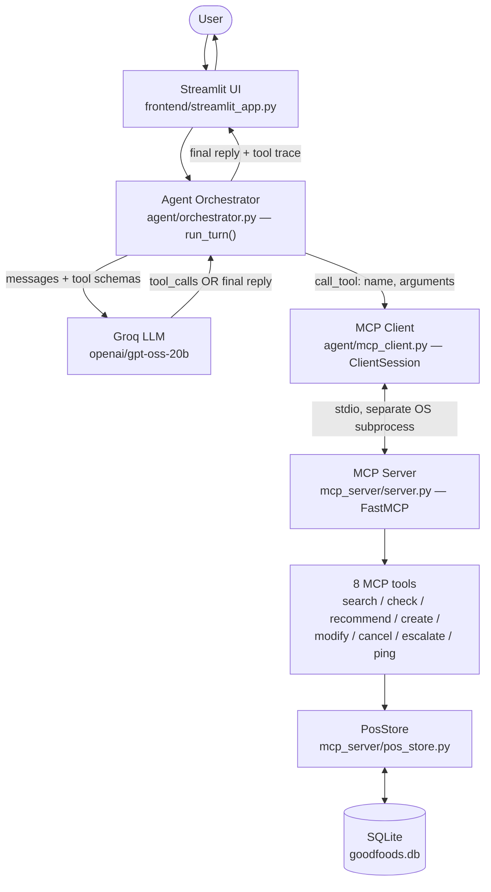

# GoodFoods AI Reservation Agent

Restaurant-reservation conversational agent for a 50-100 location chain,
built on the official MCP Python SDK, a hand-written LLM tool-calling loop
(no agent framework), and a SQLite-backed reservation store.

## Demo Video

DEMO VIDEO: [`docs/demo/sarvam_assignment_demo.mp4`](docs/demo/sarvam_assignment_demo.mp4)

Walks through restaurant discovery/recommendation, a live booking, a
modification, and a cancellation, with the tool-call trace shown for
each step.

## Contents

- [Overview](#overview)
- [Architecture](#architecture)
- [Agent / Tool-Calling Flow](#agent--tool-calling-flow)
- [MCP Architecture](#mcp-architecture)
- [Model](#model)
- [Prompt Engineering Approach](#prompt-engineering-approach)
- [Tools](#tools)
- [Recommendation System](#recommendation-system)
- [Reservation Logic](#reservation-logic)
- [Error Handling](#error-handling)
- [Example Conversations](#example-conversations)
- [Business Strategy Summary](#business-strategy-summary)
- [Assumptions](#assumptions)
- [Limitations](#limitations)
- [Future Enhancements](#future-enhancements)
- [Setup](#setup)
- [Testing](#testing)

## Overview

GoodFoods needs a conversational agent that can actually **do** something
about a reservation, not just answer questions about one. This is a chat
agent that finds restaurants, checks live availability, and books,
modifies, or cancels reservations against a real (SQLite-backed) store,
end to end, through natural conversation.

**Why an agent, not a chatbot.** A chatbot answers from a knowledge base.
This system is *action-oriented*: it reads and writes directly to the
reservation store via tool calls, and the store — not the LLM — is the
source of truth for what's actually booked. The model never states
availability or reservation details from memory; every fact it gives a
user came from a tool call in that same conversation. That distinction
is also the core of the business case; see
[Business Strategy Summary](#business-strategy-summary).

## Architecture



- **Streamlit UI** — captures messages, renders replies plus a collapsible tool-call trace, holds per-session history.
- **Agent Orchestrator** — the hand-written agentic loop: calls the LLM, executes whatever tool(s) it asks for, feeds results back, repeats until a final reply or forced escalation.
- **Groq LLM** — the only component that decides *which* tool to call, if any; see [Prompt Engineering Approach](#prompt-engineering-approach).
- **MCP Client / Server** — the official MCP Python SDK over stdio; see [MCP Architecture](#mcp-architecture).
- **PosStore / SQLite** — the actual source of truth, independent of any LLM or Python process's lifetime.

## Agent / Tool-Calling Flow

```
user message
  → LLM (sees full conversation + live MCP tool schemas)
  → LLM either replies directly, or returns tool_calls
      → crosses the MCP boundary: session.call_tool(name, arguments)
      → MCP server dispatches to the tool → pos_store → SQLite
      → result ({"success": true/false, ...}) returned over stdio
  → result appended as a `role: "tool"` message; LLM is called again
  → repeats until the LLM returns a final reply with no tool calls
→ final response rendered to the user
```

**Intent is determined entirely by the LLM.** There is no keyword
matching, regex, or `if "book" in message.lower()` routing anywhere in
this path — grep the repo and there is none. The model's reading of
`DEFAULT_SYSTEM_PROMPT` plus each tool's own JSON-schema description
(live from `list_tools()`, never a hand-maintained copy) is the *only*
thing deciding which tool gets called, if any.

An "iteration" is one round where the model is consulted (a round may
request several tools at once). `run_turn()` hard-caps this at 8
iterations; hitting the cap forces escalation instead of a 9th call.

## MCP Architecture

**MCP (Model Context Protocol)** is the open protocol used here to
expose reservation tools to the LLM in a standardized way, instead of a
bespoke function-calling wrapper.

- **Server** (`mcp_server/server.py`) — built with `mcp.server.fastmcp.FastMCP`. Every `@mcp.tool()` function becomes a tool, with its type hints and docstring becoming the JSON schema and description automatically.
- **Client** (`agent/mcp_client.py`) — wraps `mcp.ClientSession` / `stdio_client`. `mcp_session()` spawns `mcp_server/server.py` as a **separate OS subprocess** and performs the MCP handshake.
- **Transport: stdio.** Real inter-process JSON-RPC, not a mock — killing the subprocess (as `manual_conversations.py`'s scenario 5 actually does) produces a genuine `ClosedResourceError`.
- **Tool discovery** — the orchestrator calls live `session.list_tools()` and converts the result via `mcp_tools_to_openai_schemas()`. A tool added/changed in `server.py` is visible to the model on the next process start, no other code change needed.
- **Tool execution** — `make_mcp_call_tool()` calls `session.call_tool()`, checks `result.isError`, and parses the JSON text response. A `{"success": false, ...}` body is not an error at this layer; see [Error Handling](#error-handling).

Verify it yourself: `python tests/roundtrip_check.py` starts the real
server subprocess and prints a live `list_tools()` + `call_tool("ping")`
round trip.

## Model

The spec asks for "llama-3.3-8b (or similar size small model)." Llama-3.3
was only ever released as a 70B model — no 8B variant exists. The
original choice was **Llama-3.1-8B-Instant** on Groq. **That model is
now gone**: as of 2026-09-04, `client.models.list()` against a real Groq
key returns no Llama models, and requesting it fails with a live 404. We
use **`openai/gpt-oss-20b`** instead — the closest remaining small/open
model on Groq's lineup, verified live to correctly emit `tool_calls`.
`agent/orchestrator.py`'s `DEFAULT_GROQ_MODEL` is the single source of
truth for the model id.

| | |
|---|---|
| **Model** | `openai/gpt-oss-20b` |
| **Provider** | Groq |
| **API** | OpenAI-compatible `chat.completions.create`, via the `groq` SDK |
| **Why this model** | Closest small/open model to the spec's ask with confirmed live tool-calling and Groq's low-latency inference |
| **Why it changed** | The originally-planned Llama-3.1-8B-Instant was removed from Groq's lineup entirely partway through this project |

## Prompt Engineering Approach

**Philosophy: the system prompt is the *only* routing layer.** No code
classifies intent or matches keywords — everything the model needs lives
in `DEFAULT_SYSTEM_PROMPT` plus each tool's docstring. If the prompt
doesn't say it, the model doesn't know it, so behavior stays auditable by
reading two things instead of hunting through business logic.

- **Never invent domain facts.** The prompt states directly it has *"no knowledge of any restaurant, availability, or reservation beyond what a tool call returns"* — never invent a name, id, or slot. The fixed 2-hour slot grid is called out up front so the model never proposes an off-grid time before checking a tool.
- **When to ask vs. act.** The model is told to ask for any required detail (date, party size, phone, restaurant) rather than guess; each tool's docstring states its own preconditions.
- **Tool selection lives in each docstring, not the system prompt.** The system prompt gives one line on *when* to reach for a tool; the argument-level contract lives in the tool schema itself, next to where the model needs it.
- **A `{"success": false, ...}` result is information, not an error.** The prompt is explicit that this should be explained in plain language and never retried with the same arguments — this is what makes the fully-booked → alternative-recommendation flow (Example #5 below) work with no special-case code.
- **Booking safety is enforced by the tools, not the prompt.** `create_reservation`/`modify_reservation` structurally reject any off-grid slot, and `pos_store`'s capacity/double-booking guards run unconditionally regardless of what the model does.
- **Human escalation is never the model's call.** Every *forced* escalation (transport exhausted, LLM failure, iteration cap) triggers directly in orchestrator code, bypassing the model — a model given the option to retry "just once more" can rationalize that indefinitely.
- **Multi-turn context** is just the full message list persisted in `st.session_state` across the browser session — a follow-up like "move that to 9pm" resolves against the reservation id already seen earlier, no separate memory layer.

## Tools

| Tool | Purpose | Read/Write | Example |
|---|---|---|---|
| `ping` | Liveness check | Read | `ping()` → `{"success": true, "message": "pong"}` |
| `search_restaurants` | Hard AND filter by cuisine/location/price/min. capacity | Read | `search_restaurants(cuisine="Italian", location="Indiranagar")` |
| `check_availability` | List a restaurant's 6 fixed slots + which have room | Read | `check_availability(restaurant_id=46, date="2026-10-05", party_size=2)` |
| `recommend_restaurants` | Ranked, availability-gated suggestions | Read | `recommend_restaurants(date="2026-10-05", party_size=2, cuisine="Italian")` |
| `create_reservation` | Book a table (capacity + double-booking guarded) | Write | `create_reservation(restaurant_id=46, customer_name="Alex Doe", customer_phone="555-0100", party_size=2, slot="2026-10-05 19:00")` |
| `modify_reservation` | Change party size and/or slot | Write | `modify_reservation(reservation_id=7, slot="2026-10-05 21:00")` |
| `cancel_reservation` | Cancel; frees seats + slot immediately | Write | `cancel_reservation(reservation_id=7)` |
| `escalate_to_human` | Hand off to staff (stub — see [Limitations](#limitations)) | Write | `escalate_to_human(reason="refund request")` |

## Recommendation System

`recommend_restaurants` ranks candidates by a weighted blend of five 0–1
signals summing to 1.0:

| Signal | Weight | What it measures |
|---|---|---|
| Cuisine match | 0.30 | Exact match to requested cuisine |
| Vibe/preference match | 0.25 | Fraction of fixed-vocabulary tags found as substrings of freeform `preference` text |
| Rating | 0.20 | Seeded 1.0–5.0 rating, rescaled to 0–1, capped so it can't dominate a good match |
| Price fit | 0.15 | Graded distance between price tiers (not a hard cutoff) |
| Proximity | 0.10 | 1.0 for exact neighborhood match, 0.0 otherwise (no real geo-distance data) |

**Availability is a hard gate applied before scoring, not a sixth
signal** — zero open slots means excluded entirely, no score can
compensate.

**Why not just ask the LLM to pick.** The score is computed
deterministically in code from stored attributes and returned already
sorted, with a full `score_breakdown` per candidate — reproducible,
auditable, and immune to hallucinating a restaurant that can't seat the
party.

## Reservation Logic

- **Availability** — 6 fixed daily slots (11:00–21:00, every 2 hours), checked per party size.
- **Capacity validation** — every create/modify re-checks total confirmed seats at that slot against restaurant capacity.
- **Duplicate-booking protection** — rejected if the same `customer_phone` already has a confirmed reservation at that restaurant/slot, even if capacity would allow it.
- **Create / modify / cancel** — all run through `pos_store.py`'s guards; a cancelled reservation counts toward neither check, so cancelling immediately frees both for a new booking.
- **Persistence** — a real SQLite file, not in-memory — Streamlit reruns the whole script every interaction, so state has to survive outside Python memory.

Both guards are pytest-covered (`tests/test_pos_store.py`): exact-capacity
fit, over-capacity rejection, double-booking rejection, cancel-then-rebook,
and a failed modification leaving the original untouched.

## Error Handling

`run_turn()` distinguishes three failure categories on purpose:

1. **Business errors** — a tool call *completes normally* with `{"success": false, ...}`. Valid data, not a call failure — handed to the model with no retry (retrying "restaurant's full" can't change the answer).
2. **Tool/transport failures** — a tool call *raises*. Retried up to 3x with exponential backoff (0.5s/1s/2s); if exhausted, `escalate_to_human` is called **directly in code**.
3. **LLM/API failures** — the model call itself raises (rate limit, auth, network). **Not retried** — straight to forced escalation, since a rate-limit wait is too long to be useful mid-conversation.

A fourth, independent limit — **8 tool-call iterations** — forces the
same path if the model never converges.

Escalation is always forced in code, never left to the model. If even
`escalate_to_human` fails after retries, the user gets a fixed apologetic
fallback rather than a crash — observed live in Example #6 below. All
paths are pytest-covered against a scripted fake LLM
(`tests/test_orchestrator.py`), no API key required.

## Example Conversations

All examples below are **real, captured output** from a live run against
the actual Groq API and a real `mcp_server/server.py` subprocess
(`python tests/manual_conversations.py`, 2026-09-07) — not hand-written.

**1–2. Discovery → booking** (one continuous conversation)
> "Book a table for 2 at an Italian place on 2026-10-05 around 7pm. Alex
> Doe, 555-0100, no preference — pick a good one and confirm it."

`recommend_restaurants(cuisine="Italian", ...)` → top pick The Bold
Terrace, score 0.985 → `check_availability(46, ...)` → all 6 slots open →
`create_reservation(...)` → confirmed, id=7. Reply: *"✅ Your reservation
is confirmed! The Bold Terrace, 2026-10-05 19:00, party of 2..."* — 3
iterations, the model chose the whole tool sequence itself.

**3. Modification**
> "Actually, move that to 9pm instead."

`modify_reservation(reservation_id=7, slot="2026-10-05 21:00")` →
confirmed. Resolved "that" to id=7 purely from earlier context — no
re-lookup needed.

**4. Cancellation**
> "On second thought, cancel that reservation."

`cancel_reservation(reservation_id=7)` → status now cancelled. Reply
confirms plainly and offers to help book something else.

**5. Edge case — restaurant unavailable, real alternatives offered**
A restaurant was pre-filled fully booked for this scenario.
> "Book me at Sadashivanagar Garden for 2 on 2026-11-11 ~7pm. If they
> can't seat us, suggest something else nearby."

`search_restaurants` finds it → `check_availability` → all 6 slots
unavailable → `recommend_restaurants(date=..., location="Sadashivanagar", ...)`
→ 5 real alternatives, correctly excluding the full restaurant. The
model presented a table of options and asked which to book. *(Honest
note: it got there by omitting the `cuisine` filter rather than passing
`exclude_restaurant_id` as the prompt suggests — still correct, since the
availability gate removes the full restaurant either way.)*

**6. Edge case — transport failure → forced escalation**
The real MCP server subprocess was killed mid-conversation (via `psutil`,
not simulated) right after one successful call. `check_availability`
then fails 3x with `ClosedResourceError`, `escalate_to_human` is
attempted and *also* fails (subprocess is genuinely dead). Final reply:
*"We're having trouble completing this right now and our escalation path
is also unreachable. Please try again shortly or contact us directly."*
— no traceback, no crash, a plain-language message either way.

## Business Strategy Summary

Full detail: [`docs/GoodFoods_Business_Strategy.docx`](docs/GoodFoods_Business_Strategy.docx)
(Part 1 of this submission).

**Problem → Solution.** GoodFoods loses bookings to busy phone lines,
hosts lose hours to manual admin, and no-shows leave tables empty — none
of it measured today. The fix is an action-oriented agent (not an FAQ
bot) that reads and writes directly to the reservation/POS system, with
the POS as the source of truth. Launch narrow: one channel, one
language, six core actions, 1–2 locations; recommendations, WhatsApp,
CRM, and upsell are deferred to later phases.

**KPIs** (baselines are labeled illustrative, replaced with real numbers
in Phase 0): reservation conversion (55–65% phone → 75–85%),
automation rate (0% → 70–80%), no-show rate (15–20% baseline → 20–30%
relative reduction), staff hours saved (~10 hrs/week → ~65–75%
reduction), plus funnel completion, handoff rate, cancellation re-fill,
utilization, upsell attach, repeat-booking, and CSAT.

**ROI.** Three mutually-exclusive incremental-reservation buckets
(missed-demand, no-show, waitlist recovery) sum to ≈$27,085 net annual
benefit per location. At a 10-location pilot, ≈$270,800/year against a
$40K–$60K shared implementation cost — payback in ~1.8–2.7 months. A
sensitivity check on the largest assumption (no-show recovery) still
holds, less dramatically, if that number comes in lower.

**Rollout.** Phase 0 (discovery) → Phase 1 (1–2 location MVP pilot) →
Phase 2 (5–10 locations, genuine A/B vs. matched controls) → Phase 3
(chain-wide) → Phase 4 (forecasting/optimization) — each with an explicit
go/no-go gate, not a big-bang launch.

**Competitive advantages.** (1) Safe transactional execution (validation,
rollback) is harder to build than an FAQ layer and is where the value
sits. (2) A reusable multi-tenant core with a thin per-location adapter
drops marginal cost per new location. (3) A closed feedback loop from
real operational outcomes — the actual moat, since a competitor can copy
the architecture in a quarter but not the accumulated operational data.

**Vertical expansion.** The core (intent detection, slot-filling,
tool-calling orchestration, notifications, analytics) is domain-agnostic;
what changes is the knowledge base and resource model — other restaurant
chains, hotels, salons/spas, healthcare, and other appointment-based
businesses.

**Key stakeholders & customers.** GoodFoods' ops/IT team (integration),
front-desk staff (pilot design, escalation path), diners, and
leadership/finance (go/no-go decisions). Potential customers beyond
GoodFoods mirror the vertical-expansion list above, restaurant chains
first.

## Assumptions

- **Fixed seatings, not arbitrary timestamps.** Every restaurant is open 11:00–22:00, one seating every 2 hours. `pos_store.py` matches slots by exact string equality — safe only because slot values are constrained to this grid upstream. No per-restaurant hours yet.
- **"Proximity" is same-neighborhood-or-not, not real distance** — no coordinates exist, so it's the lowest-weighted signal for that reason. `rating` and vibe `tags` are synthetic, seeded deterministically, not real review data.
- **Neighborhoods are real Bangalore localities; restaurants are fully synthetic**, generated deterministically, not scraped or sourced.
- **SQLite stands in for a production POS** — zero infrastructure needed for a take-home, and Streamlit's rerun-per-interaction model needs state outside Python memory. Production would integrate with GoodFoods' actual system, not just swap to a bigger database.
- **All business-case figures are illustrative**, explicitly labeled as such, meant to be replaced with real data in Phase 0.

## Limitations

- **No real POS/reservation-system integration** — SQLite is the store.
- **`escalate_to_human` is a stub** — logs and returns a fixed message; no human is actually paged.
- **Fixed slot grid only** — no arbitrary times, per-restaurant hours, or duration-aware overlap.
- **No waitlist auto-notify** — a cancelled slot isn't re-offered.
- **Single channel, single language** — web only, English only.
- **No CRM, loyalty, or persistent customer profiles** — `customer_phone` is only a dedupe key within this store.
- **No payment/deposit handling.**
- **No automated CI eval suite against the live LLM** — the manual conversation script is cost-gated, not scheduled.
- **Single-process, single-file database** — no connection pooling or concurrent-writer story beyond SQLite's own locking.
- **No authentication** — any visitor can book/modify/cancel any reservation by id.

## Future Enhancements

**Phase 2:** WhatsApp channel, waitlist auto-notify, upsell prompts,
CRM/loyalty foundation, regional-language expansion gated on measured
accuracy.

**Phase 3:** chain-wide rollout, voice channel, cross-location demand
routing, loyalty integration.

**Phase 4 / long-term:** demand forecasting, dynamic promotions, deeper
personalization from accumulated operational data, vertical expansion
into hotels, salons/spas, or healthcare scheduling.

**Technical roadmap:** real staff paging behind `escalate_to_human`;
per-restaurant operating hours; a scheduled, budget-capped re-run of the
live-LLM scenarios to catch model regressions; basic auth on
modify/cancel.

## Setup

Requires **Python 3.10+** (developed/tested on 3.14.5).

```
pip install -r requirements.txt
copy .env.example .env   # macOS/Linux: cp .env.example .env
# then fill in GROQ_API_KEY in .env
```

Seed the database (idempotent — skips if already seeded):

```
python -m mcp_server.seed_data
```

Seeds 80 restaurants (50-100 range) if `goodfoods.db` is empty, then
prints a distribution summary.

Verify the MCP round trip:

```
python tests/roundtrip_check.py
```

Run the app:

```
python -m streamlit run frontend/streamlit_app.py
```

The MCP subprocess and Groq client are cached for the app's lifetime —
restart after changing `mcp_server/` code. Use `python -m streamlit run`
if plain `streamlit run` resolves to a different Python install.

## Testing

**Automated (pytest, no API key) — 24 tests, all passing:**
```
pytest tests/
```
- `test_pos_store.py` — capacity/double-booking guards against a real temp SQLite file.
- `test_orchestrator.py` — the full agentic loop against a scripted fake LLM: every retry/escalation/iteration-cap path, asserting exact call sequences.
- `test_cuisine_normalization.py` — the synonym table, including that unknown cuisines are left unchanged, never guessed.

**MCP round trip (manual, no API key):** `python tests/roundtrip_check.py`
— verifies the real stdio subprocess and a live `ping` round trip.

**Manual live-LLM conversations (spends real Groq tokens):**
`python tests/manual_conversations.py` — 5 scenarios against the real API
and a real MCP server, including actually killing the subprocess via
`psutil` for the transport-failure case. Deliberately excluded from
pytest discovery. All scenarios in
[Example Conversations](#example-conversations) above are real, unedited
output from an actual run.

**What's verified vs. not:** all of the above were run and passed while
preparing this submission. Not covered: load/concurrency testing, and any
scheduled regression suite for LLM behavior specifically.
